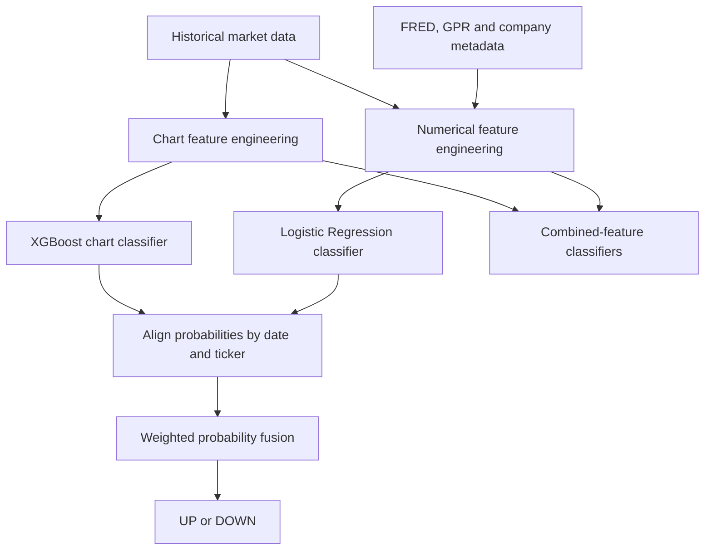

# Multifactor Stock Movement Prediction

A collaborative machine learning study investigating whether two complementary views of market behavior can improve next-trading-day stock direction classification.

**Contributors:** Hamza Eldeib (chart-reader model) and Omar Jibreen (numerical model). Developed for CSC 4740 Data Mining at Georgia State University, Fall 2026.

## Objective

Rather than predict an exact dollar price, we predict a binary outcome: **UP** if the next trading close exceeds today's close, otherwise **DOWN**. We wanted to test whether combining conventional numerical indicators with the chart patterns traders observe provides a stronger signal than either approach alone.

## Dataset and architecture

The project examined approximately 1.86 million historical daily observations across 215 stocks. Inputs include open, high, low, close and volume (OHLCV), technical indicators, company metadata, FRED macroeconomic series and geopolitical risk (GPR) features.

## Individual contributions

### Hamza Eldeib — chart-reader submodel

Hamza translated visual chart-reading concepts into 47 numerical features rather than training a computer vision model on screenshots. Features include trailing returns, moving-average relationships, trend strength, volatility, support and resistance, swing highs and lows, higher highs and lower lows, breaks of structure, candle bodies and wicks, and volume confirmation.

The selected XGBoost classifier outputs `chart_probability_up` for each Date + Ticker. Its saved handoff contained 652,911 prediction keys. Model selection used ROC-AUC with Matthews correlation coefficient (MCC) as a tie-breaker. The chart model trained through January 17, 2014; saved forecasts begin January 22, 2014.

### Omar Jibreen — numerical submodel

Omar developed the conventional numerical branch using historical price/volume variables, macroeconomic indicators and company metadata. The final separate Logistic Regression specification uses 448 inputs, including four OHLC returns relative to prior close, log-transformed volume, 440 FRED columns, lagged GPR, sector and industry. Logistic Regression provides an interpretable baseline for comparison with nonlinear models.

### Joint integration

Both probability outputs were aligned by Date + Ticker. The study compared separate-model weighted voting (50/50, 25/75, 75/25), combined-feature Logistic Regression and XGBoost, and an equal-weight vote of combined-feature models. The final combined-feature experiments used 488 inputs. All classification decisions used a 0.5 probability threshold.

## Evaluation methodology

Training, validation and test periods were separated chronologically, rather than randomly mixing historical and future observations. Next-day labels were constructed within ticker histories and boundary-crossing labels were purged. The final fusion run used a 150,000-row local training cap and evaluated all methods on 147,905 shared validation keys. The selected method was subsequently evaluated on 501,205 shared historical test keys.

Accuracy measures overall correct classifications. Balanced accuracy averages UP and DOWN recall, helping identify classifiers that favor one class. The selected method was chosen using balanced accuracy, with accuracy as a tie-breaker.

## Results

The table below uses the archived final fusion experiment (run_5), not the earlier presentation chart, which contains inconsistent comparison figures.

| Method | Validation accuracy | Balanced accuracy |
| --- | ---: | ---: |
| Training-majority dummy baseline | 48.48% | 50.00% |
| Numerical Logistic Regression | 51.52% | 50.00% |
| Chart-reader XGBoost | 50.17% | 50.20% |
| Combined-feature Logistic Regression | 51.52% | 50.00% |
| Combined-feature XGBoost | 49.19% | 50.27% |
| Separate-model vote 50/50 | 51.52% | 50.00% |
| **Separate-model vote 25/75** | **51.84%** | **50.33%** |
| Separate-model vote 75/25 | 51.52% | 50.00% |
| Combined-feature vote 50/50 | 51.52% | 50.00% |

The best validation vote used 25% numerical Logistic Regression and 75% chart XGBoost. However, it predicted UP on 99.56% of validation observations and had only 0.79% DOWN recall. It achieved 49.83% accuracy and 49.46% balanced accuracy on the historical holdout. These results do not establish a reliable trading edge.

See [evaluation details](docs/evaluation.md) and [validation metrics](results/model_comparison.csv).

## Technology stack

Python, Pandas, NumPy, Scikit-learn, XGBoost, Matplotlib, Jupyter, yfinance, Requests and FRED API. The original project contains ingestion scripts, exploratory notebooks, chart feature engineering, model comparison code and experiment artifacts.

## Limitations and lessons

- More complex features and model combinations do not necessarily improve generalization.
- Historical FRED revisions, static company metadata and stock-universe selection can introduce bias; point-in-time data would strengthen the evaluation.
- The saved chart model's earlier selection period overlaps the shared validation period; the historical test period had also been inspected in earlier experiments.
- Probability calibration and statistical significance were not assessed.
- Full reproduction requires the original datasets, cached external data and chart probability handoff, some of which are absent from the supplied archive.

This is an educational data-mining experiment, not financial advice or a validated trading strategy.

## Portfolio edition

This public edition documents the methodology and results with contributor attribution. The original collaborative repository remains separate. Raw third-party datasets, credentials, large generated artifacts and private collaborative source are not redistributed here. 
